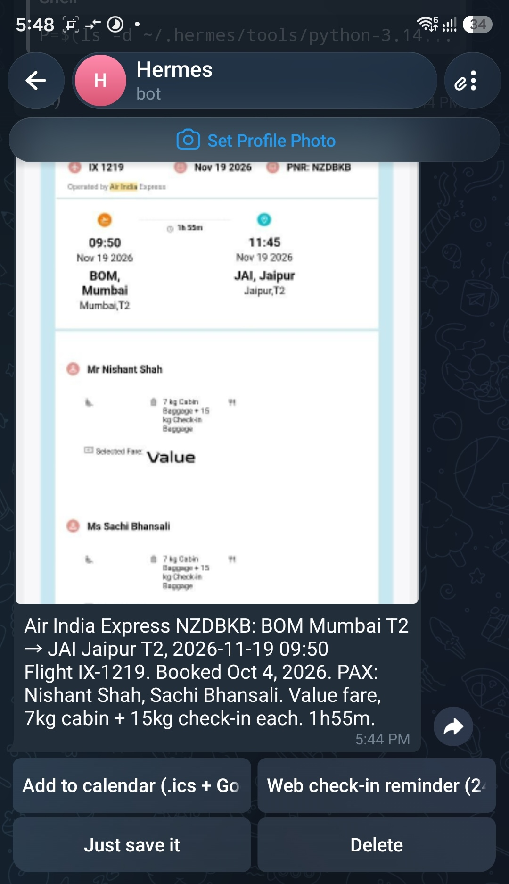
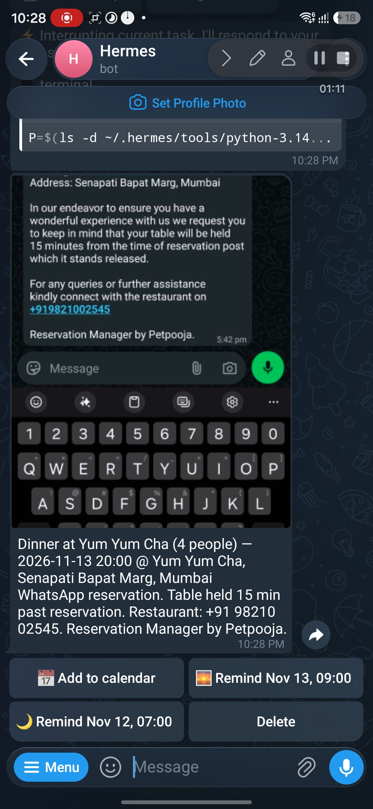
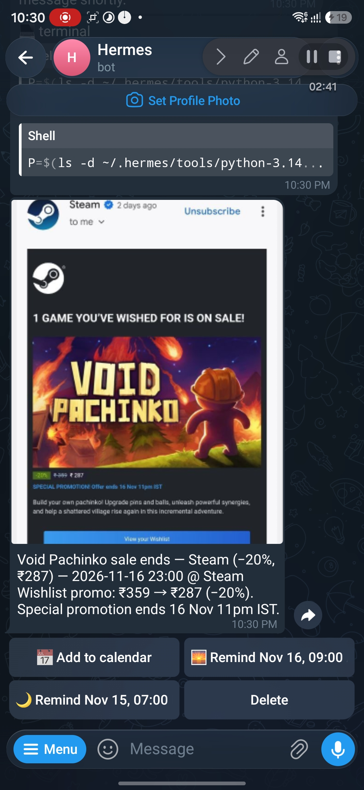
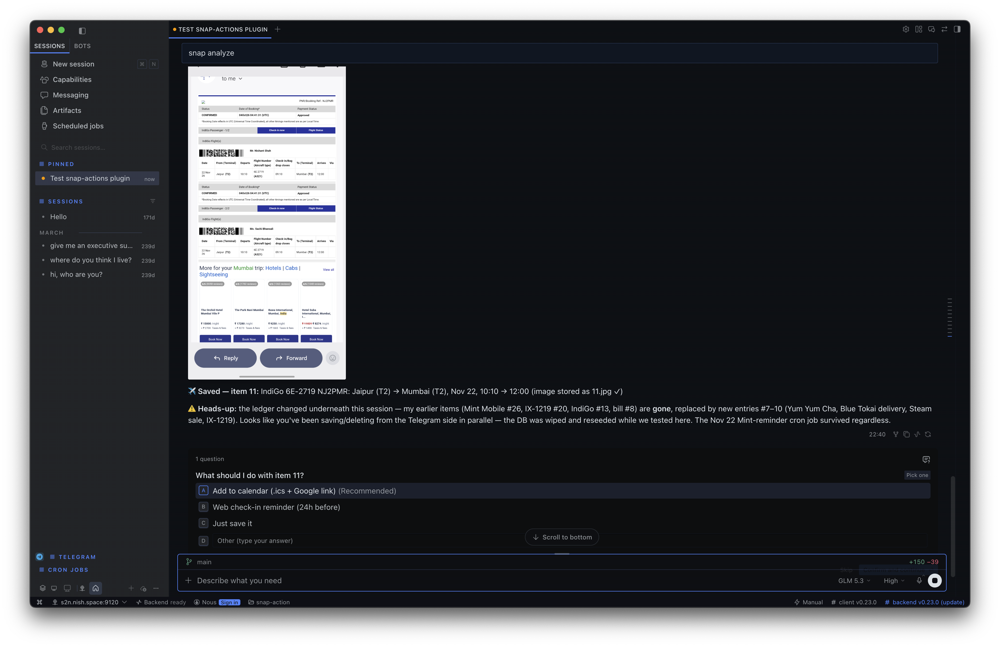

# snap-action

**Screenshot-to-action plugin for [Hermes Agent](https://github.com/NousResearch/hermes-agent)** — send a booking, bill, ticket or shipment screenshot to your agent and get it filed, classified, and turned into tappable actions. Every reminder, calendar entry and ledger query is executed in code: instant, with zero LLM calls.

## Screenshots → actions

| Telegram — travel | Telegram — dinner reservation | Telegram — freeform promo |
|---|---|---|
|  |  |  |

**Desktop — the same flow, no Telegram needed:**



```text
You:  [screenshot of flight e-ticket — no caption]
Bot:  ✈️ Snap 7 — Air India Express IX-1219 BOM → JAI · Nov 19, 09:50 · PNR NZDBKB
      [📅 Add to calendar] [⏰ Check-in Nov 18, 09:50 AM]
      [Save only] [🗑 Delete]
You:  (taps calendar)
Bot:  📅 Calendar entry sent — snap-7.ics attached + one-tap Google Calendar link
```

**Time-aware actions** — every button carries the exact time it will fire:

- `⏰ Check-in Nov 18, 09:50 AM` — web check-in opens 24 h before departure
- `🌅 Remind Nov 13, 09:00 AM` / `🌙 Remind Nov 12, 07:00 PM` — morning-of and evening-before, IST-correct
- `📦 Delivery-day reminder` + `Follow up Nov 15` — chase the courier automatically

## What it catches (kinds)

| Kind | Captures | Smart actions |
|------|----------|---------------|
| `travel` | Flight/train/bus/hotel bookings | Calendar (.ics + Google link), web check-in reminder (24 h before) |
| `event` | Tickets, reservations, appointments, sales | Calendar, morning-of / evening-before reminders |
| `bill` | Receipts, bills, invoices | Expense logging, **split bill** with per-person settle tracking, due-date reminder |
| `subscription` | Renewal/pricing emails | Reminder 3 days before renewal (cancel/keep decision) |
| `payment` | UPI/bank transfer confirmations | Settle an open bill split |
| `task` | Chat screenshots with commitments | One reminder per commitment |
| `warranty` | Purchase receipts | Reminder 30 days before warranty expires |
| `delivery` | Shipment notices | Delivery-day reminder, not-delivered follow-up |
| `other` | Anything else | Free-form note |

Actions are **timing-aware**: an event tonight shows a "1 hour before" option; next week's dinner shows morning/evening options. Button labels show the exact fire time.

## Install

```bash
hermes plugins install nini1294/snap-action
hermes plugins enable snap-action
```

Or manually: clone into `~/.hermes/plugins/snap-action/`, then `hermes plugins enable snap-action`.

## How it works

Your agent's built-in vision reads the screenshot; this plugin supplies the **ledger and the hands**:

- **Code-side fast path** — recall, calendar, reminders, split-settle and deletes run inside the callback handler: no agent turn, no waiting. `/snaps recall 7` → photo + buttons in ~1 second
- **Auto-capture** — a bare screenshot (no caption) gets a code-side *Save / Ignore* offer; tapping Save runs the classify → save → keyboard flow
- **Data-driven kind registry** (`kinds.py`) — a new use case is one dict entry, no code changes
- **SQLite ledger** via Hermes `plugin_db()` — survives plugin updates and removals (`~/.hermes/plugin-data/snap-action/`); durable copies of captured images live alongside it
- **Bundled workflow skill** — teaches any Hermes session the classify → extract → save → keyboard loop
- **`/snaps` command** — list the ledger; `/snaps recall <id>` re-sends any item with its actions; `/snaps stats` shows open bill splits and upcoming dates
- **Telegram + desktop/CLI** — inline keyboards on Telegram; on desktop and CLI the same recall renders as text with numbered actions

Reminder actions are executed through Hermes cron, so they fire on any platform your gateway runs on.

## Tools

`snap_save` · `snap_list` · `snap_get` · `snap_update` · `snap_stats` · `snap_delete` · `snap_keyboard`

## Notes

- Amounts and currencies are kept exactly as shown in the screenshot — never converted silently
- All times are IST-aware (`Asia/Kolkata`), independent of the host clock
- All data stays local in your Hermes home directory; no external API calls, no credentials required

## Status

v0.1.0 — validated with `hermes plugins validate` and `hermes plugins doctor --ci`.
